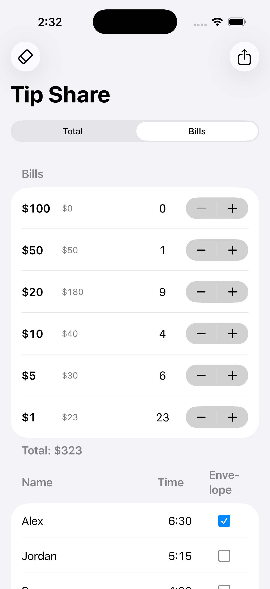

# Tip Share

iPhone app that splits tips by time worked (h:mm), rounded to whole dollars. Built with AI assistance (Claude Code).

- **Total** — type the total; shares always add up to it (rounded to the nearest dollar).
- **Bills** — count the $100/$50/$20/$10/$5/$1 bills. People with **Envelope** checked are paid first in the
  fewest bills; the remaining bills are dealt out to everyone else. A bill nobody can take without being overpaid
  is shown as "couldn't split" — break it and update the counts.

Names, times, envelope checks and counts are saved on the phone. The share button copies a text summary.

Logic lives in `Packages/TipShareCore` (tested); the app is `TipShare/`. Project is generated from `project.yml`.

    scripts/test.sh      # split-logic tests
    scripts/build.sh     # simulator build
    scripts/install.sh   # simulator "Thuban iPhone" + signed install on a paired iPhone (unlock it first)

Requires Xcode 26 and [XcodeGen](https://github.com/yonaskolb/XcodeGen). For a device install, copy your team id into
`Config/Signing.xcconfig` as `DEVELOPMENT_TEAM = <id>`.
